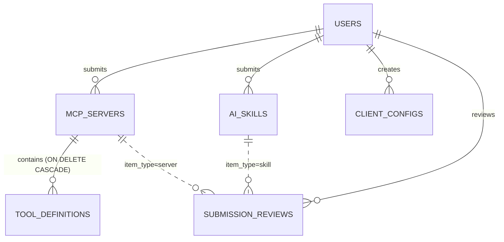

# ContextForge API Reference (v1)

Base URL: `http://localhost:5000/api/v1` (the Vite dev server proxies `/api` from `http://localhost:3000`).
Postman: [`docs/postman/ContextForge.postman_collection.json`](postman/ContextForge.postman_collection.json) with [`local.postman_environment.json`](postman/local.postman_environment.json).

## Roles

| Role | Who | How it is identified |
|---|---|---|
| Public | Anyone, no account | No token |
| Developer | Registered user (role `developer`, or `public` account that logged in) | JWT in `Authorization: Bearer <token>` or the `token` HttpOnly cookie |
| Owner | The Developer whose `user_id` equals the item's `submitted_by` | Compared on the server from the JWT, never from the URL |
| Admin | Role `admin` (seeded, cannot be self-registered) | JWT claim `role: admin` |

## Core Endpoints

| # | Method | Endpoint Path | Description | Access Role | Success | Errors |
|---|---|---|---|---|---|---|
| 1 | GET | `/health` | Service status and uptime | Public | 200 OK | - |
| 2 | POST | `/auth/register` | Create an account (password hashed with bcrypt cost 12; role `developer` or `public` only) | Public | 201 Created | 400, 409, 429 |
| 3 | POST | `/auth/login` | Check credentials, return a JWT and set the HttpOnly cookie | Public | 200 OK | 400, 401, 429 |
| 4 | GET | `/auth/me` | Profile of the user in the token | Developer, Admin | 200 OK | 401 |
| 5 | POST | `/auth/logout` | Clear the session cookie | Public | 200 OK | - |
| 6 | GET | `/servers` | List verified, non-deleted MCP servers. Query: `page`, `limit` (max 100), `search` | Public | 200 OK | - |
| 7 | GET | `/servers/me` | The caller's own servers in every review state, with `latest_review` | Developer, Admin | 200 OK | 401 |
| 8 | GET | `/servers/:id` | Server detail with tools and author. Unverified items are visible to Owner and Admin only | Public | 200 OK | 400, 404 |
| 9 | POST | `/servers` | Submit a server. Saved as `is_verified=false` and queued for review | Developer, Admin | 201 Created | 400, 401, 409 |
| 10 | PATCH | `/servers/:id` | Update metadata. An Owner edit resets `is_verified` and re-queues review | Owner, Admin | 200 OK | 400, 401, 403, 404 |
| 11 | DELETE | `/servers/:id` | Soft delete (`is_deleted=true`, `deleted_at=now()`) | Owner, Admin | 204 No Content | 400, 401, 403, 404 |
| 12 | GET | `/servers/:id/tools` | Tool definitions with `input_schema` and `risk_level` | Public (unverified server: Owner, Admin) | 200 OK | 400, 404 |
| 13 | POST | `/servers/:id/tools` | Add a tool (`risk_level`: `read_only`, `network`, `filesystem`, `destructive`) | Owner, Admin | 201 Created | 400, 401, 403, 404 |
| 14 | DELETE | `/servers/:id/tools/:toolId` | Remove a tool from the server | Owner, Admin | 204 No Content | 400, 401, 403, 404 |
| 15 | GET | `/skills` | List verified skills. Query: `page`, `limit`, `search`, `client` | Public | 200 OK | - |
| 16 | GET | `/skills/me` | The caller's own skills in every review state, with `latest_review` | Developer, Admin | 200 OK | 401 |
| 17 | POST | `/skills/scan` | Dry-run of the prompt-injection scanner. Nothing is stored | Developer, Admin | 200 OK | 400, 401 |
| 18 | GET | `/skills/:id` | Full `skill_content`, tags, compatible clients, scan flags | Public (unverified: Owner, Admin) | 200 OK | 400, 404 |
| 19 | POST | `/skills` | Submit a skill. Scanned, saved unverified, queued (flagged if the scan hits) | Developer, Admin | 201 Created | 400, 401, 409 |
| 20 | PATCH | `/skills/:id` | Update a skill. Content is re-scanned; an Owner edit re-queues review | Owner, Admin | 200 OK | 400, 401, 403, 404 |
| 21 | DELETE | `/skills/:id` | Soft delete | Owner, Admin | 204 No Content | 400, 401, 403, 404 |
| 22 | POST | `/configs/generate` | Build a client config from verified servers/skills in one transaction and save an immutable snapshot | Public (user attached when logged in) | 201 Created | 400, 429 |
| 23 | GET | `/configs/me` | The caller's generated config history, newest first | Developer, Admin | 200 OK | 401 |
| 24 | GET | `/configs/:id` | Retrieve a snapshot by id (unchanged even if a server is later deleted) | Public | 200 OK | 400, 404 |
| 25 | GET | `/admin/metrics` | Users by role, registry lifecycle counts, review queue, configs by client, top downloads | Admin | 200 OK | 401, 403 |
| 26 | GET | `/admin/submissions` | Review queue. Query: `status`, `item_type`, `flagged_by_scan`, `page`, `limit` | Admin | 200 OK | 400, 401, 403 |
| 27 | POST | `/admin/submissions/review` | Approve or reject a server/skill; flips `is_verified` in a transaction | Admin | 200 OK | 400, 401, 403 |
| 28 | POST | `/admin/takedown` | Emergency takedown: unverify + soft delete + audit entry | Admin | 200 OK | 400, 401, 403, 404 |
| 29 | POST | `/admin/sync/github` | Refresh GitHub stars and contributors for listed servers | Admin | 200 OK | 401, 403 |
| 30 | POST | `/admin/import/github` | Read skills or MCP servers from a public GitHub URL into the review queue (unverified, never auto-approved) | Admin | 200 OK, 201 Created | 400, 401, 403, 429 |
| 31 | POST | `/admin/submissions/approve-clean` | Approve every pending imported listing the scanner did not flag, in one decision | Admin | 200 OK | 400, 401, 403 |

All routes are prefixed with `/api/v1`. Any unknown route returns 404 `NOT_FOUND`.

## Response envelope

```json
{ "success": true, "data": {}, "error": null, "pagination": { "page": 1, "limit": 20, "total": 42, "totalPages": 3 } }
```

Errors use the same shape with `success: false` and `error: { code, message, details? }`. A 204 response has no body.

| HTTP | `error.code` | When |
|---|---|---|
| 400 | `VALIDATION_ERROR`, `INVALID_PARAMS` | Body or query fails the zod schema |
| 400 | `INVALID_ID` | A path id is not a UUID |
| 400 | `INVALID_SELECTION` | Config generation references an unverified, deleted or missing item; `details` lists the rejected ids |
| 400 | `POLYMORPHIC_REFERENCE_ERROR` | Review `item_type` does not match the table of `item_id` |
| 401 | `UNAUTHORIZED`, `INVALID_TOKEN`, `INVALID_CREDENTIALS` | Missing or bad token, wrong password |
| 403 | `FORBIDDEN` | Not the Owner, or not an Admin |
| 404 | `SERVER_NOT_FOUND`, `SKILL_NOT_FOUND`, `TOOL_NOT_FOUND`, `NOT_FOUND` | Missing, deleted, or hidden from this caller |
| 409 | `EMAIL_ALREADY_EXISTS`, `SERVER_NAME_EXISTS`, `SKILL_NAME_EXISTS` | Unique constraint |
| 429 | `RATE_LIMITED` | Over 60 req/min per IP, or 10 req/min on login, register and generate. `Retry-After` says when to retry |
| 500 | `INTERNAL_SERVER_ERROR` | Unexpected error; production hides the message |

## Importing from GitHub

`POST /admin/import/github` body: `{ "url": "https://github.com/<owner>/<repo>[/tree/<ref>/<path>]" | "https://github.com/topics/<topic>", "kind": "skill" | "mcp", "limit": 1-100 (default 20), "dry_run": boolean }`.

- **Sources.** A repository (every `SKILL.md` in it, optionally under a `tree` path), a topic page (the most-starred repositories for that topic, through the GitHub search API), an "awesome" list (each linked repository becomes a candidate) or a monorepo of servers (`src/<name>/README.md`).
- **Where it reads.** Only `api.github.com` and `raw.githubusercontent.com`. Files are fetched at one pinned commit, which is stored in `source_ref`. Any other host, scheme, port or user-info in the URL is a 400 `INVALID_IMPORT_URL` before any request is made.
- **What it stores.** Every item is created with `is_verified = false`, a pending review whose note names the source and license, and `source_url`, `source_license`, `source_ref`. Skills pass the prompt-injection scanner; a flagged skill is marked on its review.
- **MCP servers.** The install command and tool list are read from the README. An install command is kept only if it is a plain `npx`, `uvx` or `docker run` line without shell syntax. Tool risk levels are a keyword guess and the review note says so. A server whose README gives no safe install command or no tool list is skipped and reported, not guessed.
- **Idempotent.** Importing the same URL again creates nothing: items with the same name and source are reported as `already imported`. A name used by another listing gets the repository owner as a suffix.
- **Quota.** Without `GITHUB_PAT` GitHub allows 60 REST calls and 10 searches per hour. When the quota runs out the response is `200` with `partial: true` and `stopped_reason`; items saved before that stay, and running it again continues.
- **Approving.** `POST /admin/submissions/approve-clean` with `{ "item_type": "skill" | "server" }` approves the pending imports with no scanner flag and leaves the rest. It never touches a listing that was submitted by hand.

## Data model

Six tables in PostgreSQL (Supabase). Primary keys are UUIDs named after the table (`user_id`, `server_id`, ...).



| Table | Purpose | Key relations |
|---|---|---|
| `users` | Accounts and roles | parent of servers, skills, configs, reviews |
| `mcp_servers` | MCP server listings, soft delete, GitHub metrics, `source_*` provenance for imports | `submitted_by` -> `users` (RESTRICT) |
| `tool_definitions` | Tools exposed by a server with risk level and JSON schema | `server_id` -> `mcp_servers` (CASCADE) |
| `ai_skills` | SKILL.md content, compatible clients, scan flags, `source_*` provenance for imports | `submitted_by` -> `users` (RESTRICT) |
| `client_configs` | Immutable generated config snapshots | `user_id` -> `users` (SET NULL) |
| `submission_reviews` | Review queue and audit log (approve, reject, takedown) | `reviewer_id` -> `users`; polymorphic `item_type` + `item_id` |

## Security notes

| Risk | Control | Test |
|---|---|---|
| A01 Broken Access Control | Owner check from JWT on every write; admin router requires role | `servers.test.ts`, `skills.test.ts`, `scanAndTools.test.ts`, `admin.test.ts` |
| A02 Cryptographic Failures | bcrypt cost 12; production refuses to start without a 32+ char `JWT_SECRET`; env vars stored as names only | `env.test.ts`, `configGenerator.test.ts` |
| A03 Injection | Prisma parameterized queries; UUID guard on path ids | `servers.test.ts` (AC11) |
| A04 Insecure Design | Owner edits drop verification and re-queue review | `servers.test.ts` (AC2), `skills.test.ts` (AC1) |
| A05 Misconfiguration | helmet, CORS limited to `CLIENT_URL`, generic 500 in production | - |
| A07 Auth Failures | 10 req/min on login and register | `rateLimit.test.ts` (AC5) |
| A10 SSRF | GitHub sync only calls `api.github.com` for parsed `github.com/<owner>/<repo>` URLs | `githubSync.test.ts` |
| LLM01 Prompt Injection | Heuristic scanner on create and edit; flagged items marked in the admin queue | `scanner.test.ts`, `skills.test.ts` |
| Concurrency | Config generation re-checks verification inside the transaction | `configs.test.ts` (AC4) |
